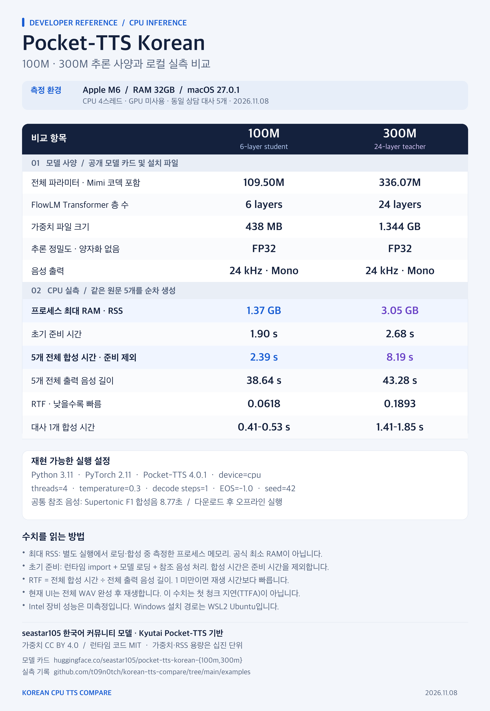

# Korean CPU TTS Compare

같은 한국어 문장을 **Supertonic 3, MeloTTS Korean, Piper KSS, Pocket-TTS Korean 100M·300M, Ppaso-TTS**로 합성해 브라우저에서 나란히 듣는 로컬 도구입니다. 직접 입력한 문장을 모델 순서대로 재생하고, 발음·자연스러움 점수와 메모를 CSV로 저장할 수 있습니다. 합성에는 GPU나 외부 TTS API가 필요하지 않습니다. 설치할 때만 모델을 내려받습니다.

| 화면의 모델 | 음성·실행 방식 |
|---|---|
| Supertonic 3 | F1 등 고정 화자 선택 · ONNX CPU |
| MeloTTS Korean | KR 단일 화자 · PyTorch CPU |
| Piper KSS | KSS 단일 화자 · ONNX CPU |
| Pocket-TTS Korean 100M | 한국어 커뮤니티 모델 · 공통 합성 참조 음성 · PyTorch CPU |
| Pocket-TTS Korean 300M | 100M과 같은 참조 음성 · 더 큰 한국어 모델 · PyTorch CPU |
| Ppaso-TTS | 한국어 여성 단일 화자 · 경량 ONNX CPU |

## 사용 방법

1. 아래에서 운영체제에 맞게 설치하고 서버를 실행합니다.
2. 브라우저에서 **http://127.0.0.1:8766**을 엽니다.
3. **입력 비우기**를 누르고 문장을 입력합니다. 한 줄에 한 문장, 최대 20문장·문장당 500자입니다. **발음 비교 문장**으로 발음 점검용 8문장, **상담 대사 불러오기**로 아래 상담 대사 5개를 사용할 수도 있습니다.
4. 모델을 고르고 **비교 음성 만들기**를 누릅니다. 문장별 플레이어나 **모델 순서대로 듣기**로 재생합니다.
5. 점수와 메모를 남긴 뒤 **전체 평가 CSV**를 누릅니다. 개별 WAV도 다운로드할 수 있습니다. 모델 체크를 해제하면 화면의 해당 결과가 숨겨지며, CSV에는 해당 작업의 모든 모델 평가가 포함됩니다.

설치 스크립트는 각 모델의 짧은 한국어 합성을 확인합니다. 기본 8문장의 전체 비교 음성은 화면에서 **비교 음성 만들기**를 눌러 생성합니다.

## 상담 대사 음성 예시

제공받은 상담 대사 5개를 각 모델로 합성했습니다. **Supertonic 3은 F1, MeloTTS는 KR, Piper는 KSS, Ppaso는 기본 여성 화자**를 사용합니다. **Pocket 100M·300M은 동일한 Supertonic F1 합성 참조 음성**을 사용합니다. MP3 링크를 누르면 브라우저에서 듣거나 파일로 저장할 수 있습니다. 모델마다 화자와 음량이 다르므로 발음과 문장 흐름을 중심으로 비교하세요. 대사 원문은 [data/counseling-samples.json](data/counseling-samples.json)에 있습니다. 저장소의 MIT 라이선스는 이 프로젝트의 코드에 적용됩니다. 음성 예시를 다른 용도로 사용할 때에는 모델별 사용 조건도 확인하세요.

### 1. 공감과 수용

> 그동안 혼자서 많은 걸 감당해 오셨던 것 같아요. 어떤 순간이 가장 힘들게 느껴지셨나요?

[▶ Supertonic 3](https://cdn.jsdelivr.net/gh/t09n0tch/korean-tts-compare@main/examples/audio/supertonic/s01.mp3) · [▶ MeloTTS Korean](https://cdn.jsdelivr.net/gh/t09n0tch/korean-tts-compare@main/examples/audio/melo/s01.mp3) · [▶ Piper KSS](https://cdn.jsdelivr.net/gh/t09n0tch/korean-tts-compare@main/examples/audio/piper/s01.mp3)

[▶ Pocket Korean 100M](https://cdn.jsdelivr.net/gh/t09n0tch/korean-tts-compare@main/examples/audio/pocket100/s01.mp3) · [▶ Pocket Korean 300M](https://cdn.jsdelivr.net/gh/t09n0tch/korean-tts-compare@main/examples/audio/pocket300/s01.mp3) · [▶ Ppaso-TTS](https://cdn.jsdelivr.net/gh/t09n0tch/korean-tts-compare@main/examples/audio/ppaso/s01.mp3)

### 2. 감정 탐색

> 그 상황에서 화가 나셨다고 말씀하셨는데, 혹시 그 감정 안에 서운함이나 두려움도 있었을까요?

[▶ Supertonic 3](https://cdn.jsdelivr.net/gh/t09n0tch/korean-tts-compare@main/examples/audio/supertonic/s02.mp3) · [▶ MeloTTS Korean](https://cdn.jsdelivr.net/gh/t09n0tch/korean-tts-compare@main/examples/audio/melo/s02.mp3) · [▶ Piper KSS](https://cdn.jsdelivr.net/gh/t09n0tch/korean-tts-compare@main/examples/audio/piper/s02.mp3)

[▶ Pocket Korean 100M](https://cdn.jsdelivr.net/gh/t09n0tch/korean-tts-compare@main/examples/audio/pocket100/s02.mp3) · [▶ Pocket Korean 300M](https://cdn.jsdelivr.net/gh/t09n0tch/korean-tts-compare@main/examples/audio/pocket300/s02.mp3) · [▶ Ppaso-TTS](https://cdn.jsdelivr.net/gh/t09n0tch/korean-tts-compare@main/examples/audio/ppaso/s02.mp3)

### 3. 자기이해 유도

> 스스로에게 굉장히 높은 기준을 적용하고 계신 것 같아요. 그 기준에 미치지 못했을 때 자신을 어떻게 바라보시나요?

[▶ Supertonic 3](https://cdn.jsdelivr.net/gh/t09n0tch/korean-tts-compare@main/examples/audio/supertonic/s03.mp3) · [▶ MeloTTS Korean](https://cdn.jsdelivr.net/gh/t09n0tch/korean-tts-compare@main/examples/audio/melo/s03.mp3) · [▶ Piper KSS](https://cdn.jsdelivr.net/gh/t09n0tch/korean-tts-compare@main/examples/audio/piper/s03.mp3)

[▶ Pocket Korean 100M](https://cdn.jsdelivr.net/gh/t09n0tch/korean-tts-compare@main/examples/audio/pocket100/s03.mp3) · [▶ Pocket Korean 300M](https://cdn.jsdelivr.net/gh/t09n0tch/korean-tts-compare@main/examples/audio/pocket300/s03.mp3) · [▶ Ppaso-TTS](https://cdn.jsdelivr.net/gh/t09n0tch/korean-tts-compare@main/examples/audio/ppaso/s03.mp3)

### 4. 관점 전환

> 친한 친구가 똑같은 상황을 겪고 있다면 어떤 말을 해주실 것 같으세요? 그 말을 자신에게도 해줄 수 있을까요?

[▶ Supertonic 3](https://cdn.jsdelivr.net/gh/t09n0tch/korean-tts-compare@main/examples/audio/supertonic/s04.mp3) · [▶ MeloTTS Korean](https://cdn.jsdelivr.net/gh/t09n0tch/korean-tts-compare@main/examples/audio/melo/s04.mp3) · [▶ Piper KSS](https://cdn.jsdelivr.net/gh/t09n0tch/korean-tts-compare@main/examples/audio/piper/s04.mp3)

[▶ Pocket Korean 100M](https://cdn.jsdelivr.net/gh/t09n0tch/korean-tts-compare@main/examples/audio/pocket100/s04.mp3) · [▶ Pocket Korean 300M](https://cdn.jsdelivr.net/gh/t09n0tch/korean-tts-compare@main/examples/audio/pocket300/s04.mp3) · [▶ Ppaso-TTS](https://cdn.jsdelivr.net/gh/t09n0tch/korean-tts-compare@main/examples/audio/ppaso/s04.mp3)

### 5. 변화와 회복

> 지금 당장 모든 문제를 해결할 필요는 없어요. 오늘 이야기한 것 중에서 가장 먼저 바꿔보고 싶은 부분은 무엇인가요?

[▶ Supertonic 3](https://cdn.jsdelivr.net/gh/t09n0tch/korean-tts-compare@main/examples/audio/supertonic/s05.mp3) · [▶ MeloTTS Korean](https://cdn.jsdelivr.net/gh/t09n0tch/korean-tts-compare@main/examples/audio/melo/s05.mp3) · [▶ Piper KSS](https://cdn.jsdelivr.net/gh/t09n0tch/korean-tts-compare@main/examples/audio/piper/s05.mp3)

[▶ Pocket Korean 100M](https://cdn.jsdelivr.net/gh/t09n0tch/korean-tts-compare@main/examples/audio/pocket100/s05.mp3) · [▶ Pocket Korean 300M](https://cdn.jsdelivr.net/gh/t09n0tch/korean-tts-compare@main/examples/audio/pocket300/s05.mp3) · [▶ Ppaso-TTS](https://cdn.jsdelivr.net/gh/t09n0tch/korean-tts-compare@main/examples/audio/ppaso/s05.mp3)

## Pocket Korean 개발자용 사양 이미지

100M·300M의 모델 사양, 실제 프로세스 메모리, 합성 시간과 재현 설정을 한 장으로 정리했습니다. 아래 성능은 **Apple M6 / RAM 32GB / CPU 4스레드**의 상담 대사 5개 실측이며 Intel 성능을 뜻하지 않습니다. 메모리는 별도 실행에서 측정한 최대 RSS이고 공식 최소 RAM 요구량이 아닙니다.

[PNG 원본 3200×4640](docs/images/pocket-korean-inference-specs.png) · [편집 가능한 SVG](docs/images/pocket-korean-inference-specs.svg) · [사양·메모리 측정 기록](examples/pocket-inference-specs.json) · [합성 시간 원본 기록](examples/counseling-benchmark.json)



이미지는 `uv run --with pillow python scripts/render_pocket_specs.py`로 다시 생성할 수 있습니다. 기본 글꼴은 macOS의 Apple SD Gothic Neo이며, 다른 운영체제에서는 `TTS_INFOGRAPHIC_FONT` 환경 변수에 한국어 글꼴 파일 경로를 지정하세요. PNG에는 글꼴이 이미 렌더링되어 있어 별도 설치 없이 볼 수 있습니다.

## Windows 10/11: WSL2 Ubuntu

여섯 모델을 함께 쓰는 Windows 경로는 **WSL2 Ubuntu**입니다. PowerShell을 관리자 권한으로 열고 다음을 실행합니다. Windows가 재시작을 요청하면 재시작한 뒤 Ubuntu를 엽니다. 이미 WSL2 Ubuntu가 있다면 건너뜁니다.

```powershell
wsl --install -d Ubuntu
```

이후 명령은 **Ubuntu 터미널 안에서** 실행합니다. 모델 파일은 WSL 홈 디렉터리에 두는 편이 읽기 속도에 유리합니다.

```bash
sudo apt update
sudo apt install -y git curl libsndfile1
curl -LsSf https://astral.sh/uv/install.sh | sh
source "$HOME/.local/bin/env"
cd ~
git clone https://github.com/t09n0tch/korean-tts-compare.git
cd korean-tts-compare
bash setup-all.sh
.venvs/piper/bin/python serve.py
```

Ubuntu 터미널을 열어 둔 채 Windows의 Edge 또는 Chrome에서 **http://localhost:8766**을 엽니다. [Microsoft의 WSL localhost 안내](https://learn.microsoft.com/windows/wsl/networking)에 따라 Windows 브라우저에서 WSL의 로컬 서버에 연결합니다. 서버 종료는 Ubuntu 터미널에서 `Ctrl+C`입니다. Linux에서는 PyTorch의 CPU 빌드를 설치합니다.

## macOS / Linux

`git`, `uv`, `curl`이 필요합니다. `uv`는 [공식 설치 안내](https://docs.astral.sh/uv/getting-started/installation/)에 따라 설치합니다. macOS에서는 `brew install git uv`를 사용할 수 있습니다. Ubuntu에서는 `sudo apt install -y git curl libsndfile1`을 먼저 실행합니다.

```bash
git clone https://github.com/t09n0tch/korean-tts-compare.git
cd korean-tts-compare
bash setup-all.sh
.venvs/piper/bin/python serve.py
```

macOS에서는 `start.command`를 더블클릭해 서버와 브라우저를 열 수도 있습니다. 8766번 포트가 사용 중이면 `serve.py --port 8767`로 시작하고 브라우저에서 `http://127.0.0.1:8767`을 엽니다.

## 기존 설치에 새 모델 추가하기

실행 중인 서버를 `Ctrl+C`로 종료한 뒤 저장소 폴더에서 아래 명령을 실행합니다. 기존 모델과 결과 파일은 그대로 사용합니다.

```bash
git pull --ff-only
bash setup/ppaso.sh
bash setup/pocket.sh
.venvs/piper/bin/python serve.py
```

`setup/pocket.sh`는 100M과 300M을 함께 설치하며, Python 환경은 공유합니다. 하나만 설치하려면 `bash setup/pocket100.sh` 또는 `bash setup/pocket300.sh`를 실행합니다. 나머지 모델도 `bash setup/supertonic.sh`, `bash setup/melo.sh`, `bash setup/piper.sh`로 개별 설치할 수 있습니다. 화면에서는 합성 확인을 마친 모델만 선택할 수 있습니다.

## 비교 기준과 파일

선택한 모든 모델에 **동일한 원문**을 보냅니다. 숫자 읽기와 발음 변환은 각 모델의 전처리를 그대로 사용합니다. 화자·음량·샘플레이트도 다르므로 발음 오류와 목소리 취향을 구분해 평가하세요. **RTF = 합성 시간 ÷ 생성된 음성 길이**이며 1보다 작으면 재생 시간보다 빠르게 합성한 것입니다. 모델 로딩 시간은 별도로 표시합니다. CPU 부하가 겹치지 않도록 선택한 모델은 순서대로 실행합니다. 다른 CPU의 속도 수치로 옮겨 해석할 수 없습니다.

Pocket 두 모델은 [공통 참조 WAV](examples/reference/supertonic-f1.wav)로 화자를 지정합니다. 이 파일은 Supertonic 3의 F1 프리셋으로 생성한 합성 음성이며, 비교 대사와 다른 문장을 읽습니다. 실제 인물의 녹음이 아닙니다. 생성 설정과 SHA-256은 [참조 음성 기록](examples/reference/supertonic-f1.json)에 있습니다. Pocket의 출력에는 참조 음성의 영향도 있으므로 두 모델의 차이를 비교할 때 같은 참조를 유지하세요. 화면의 Supertonic 화자 선택은 이 고정 참조를 바꾸지 않습니다.

Ppaso는 크기와 속도를 우선한 개인 공개 프로젝트로, 제작자가 기계적인 음색과 청크 사이 억양 차이를 한계로 안내합니다. Pocket 한국어판은 Kyutai 원본을 추가 학습한 커뮤니티 모델이며 숫자·영어 혼합 문장 등을 별도로 확인하는 편이 좋습니다.

기본 문장은 [data/samples.json](data/samples.json)에 있습니다. 받침·연음·겹받침, 숫자·날짜의 원문과 한글 표기, 영문 약어, 질문 억양이 포함됩니다.

| 위치 | 내용 |
|---|---|
| `outputs/<작업 ID>/job.json` | 문장, 실행 컴퓨터, 모델별 결과·오류 |
| `outputs/<작업 ID>/<모델>/*.wav` | 문장별 음성 |
| `outputs/<작업 ID>/<모델>/result.json` | 음성 길이·합성 시간·RTF |
| `outputs/<작업 ID>/<모델>/run.log` | 오류 확인용 실행 로그 |
| `data/<모델>.ready.json` | 설치와 짧은 합성 확인 표시 |

점수와 메모는 브라우저의 저장 공간에 보관됩니다. 다른 기기로 옮기거나 오래 보관하려면 **전체 평가 CSV**를 사용하세요. 모델, 캐시, 개인별 실행 기록과 입력한 문장의 생성 음성은 Git 저장소에 포함되지 않습니다. 공개 예시와 공통 참조 음성만 `examples/`에 포함합니다. 설치에는 Python 환경과 모델을 위한 수 GB의 디스크 공간이 필요하며 운영체제에 따라 달라집니다.

CLI에서도 합성할 수 있습니다.

```bash
.venvs/piper/bin/python compare.py --text "책을 읽고 밥을 먹은 뒤, 밖으로 나갔습니다." --models supertonic melo piper --threads 4

# 상담 대사 5개를 새 모델들로 비교
.venvs/piper/bin/python compare.py --samples data/counseling-samples.json --models pocket100 pocket300 ppaso --threads 4
```

## 모델 출처와 검증 범위

| 모델 | 출처·사용 조건 |
|---|---|
| Supertonic 3 | [소스](https://github.com/supertone-oss-archive/supertonic), [모델](https://huggingface.co/supertone-oss-archive/supertonic-3). 소스 MIT, 모델 OpenRAIL-M. 공식 개발·지원은 2026년 9월 종료되었습니다. |
| MeloTTS Korean | [소스](https://github.com/myshell-ai/MeloTTS), [한국어 모델](https://huggingface.co/myshell-ai/MeloTTS-Korean). MIT. CPU 실행과 한국어 전처리를 위해 `setup/melo_prepare.py`의 호환 패치를 적용합니다. |
| Piper KSS | [엔진](https://github.com/OHF-Voice/piper1-gpl), [한국어 모델](https://huggingface.co/rhasspy/piper-voices/blob/main/ko/ko_KR/kss/medium/MODEL_CARD). 엔진 GPL-3.0. 모델카드의 학습 데이터셋은 CC BY-NC-SA 4.0으로 표기되어 있어 상업용 이용 시 조건 확인이 필요합니다. |
| Pocket-TTS Korean 100M / 300M | [원본 실행기](https://github.com/kyutai-labs/pocket-tts), [한국어 100M](https://huggingface.co/seastar105/pocket-tts-korean-100m), [한국어 300M](https://huggingface.co/seastar105/pocket-tts-korean-300m). 실행기 MIT, 한국어 가중치 CC BY 4.0. `seastar105`의 한국어 커뮤니티 모델이며 Kyutai 공식 한국어 배포판은 아닙니다. |
| Ppaso-TTS | [모델·코드](https://huggingface.co/akamotaco/ppaso-tts-v1). Apache-2.0 표기. CosyVoice 교사의 합성 데이터로 학습한 한국어 개인 공개 프로젝트입니다. CPU용 ONNX 경로를 사용합니다. |

**Apple M6 · macOS · CPU 4스레드**에서 상담 대사 5개를 여섯 모델로 합성해 **30개 WAV**의 유효한 파형과 HTTP 부분 재생 응답을 확인했습니다. 같은 WAV를 위의 MP3 예시로 변환했습니다. 모델별 설치 및 짧은 한국어 CPU 합성은 Ubuntu 24.04 GitHub Actions에서도 자동 검증합니다. Windows/WSL2 실기기 합성은 아직 검증하지 않았습니다.

아래 수치는 이번 상담 5문장의 합계입니다. 합성 시간에는 모델 로딩과 MP3 인코딩을 포함하지 않습니다. 음성 길이와 말하는 속도가 모델마다 다르므로 **빠른 모델이 더 자연스럽다는 뜻은 아닙니다.** 원본 측정값은 [상담 비교 기록](examples/counseling-benchmark.json)에 있습니다.

| 모델 | 생성된 음성 합계 | CPU 합성 시간 합계 | RTF |
|---|---:|---:|---:|
| Supertonic 3 | 43.75초 | 6.68초 | 0.153 |
| MeloTTS Korean | 46.60초 | 6.21초 | 0.133 |
| Piper KSS | 38.08초 | 0.69초 | 0.018 |
| Pocket-TTS Korean 100M | 38.64초 | 2.39초 | 0.062 |
| Pocket-TTS Korean 300M | 43.28초 | 8.19초 | 0.189 |
| Ppaso-TTS | 42.57초 | 0.44초 | 0.010 |

Pocket의 참조 음성 준비 시간은 로딩 시간에 포함됩니다. 모든 모델은 한 프로세스에서 5문장을 순서대로 생성하며 이후 문장은 초기화된 전처리·추론 상태를 재사용합니다. 설치한 폴더를 옮겼다면 설치 스크립트를 다시 실행해 로컬 모델 경로를 갱신하세요. 플랫폼별 설치 문제는 실행 로그와 함께 GitHub 이슈로 알려 주세요.

휴대폰 접속에는 별도의 HTTPS 터널이 필요합니다. `mobile_gateway.py`는 개인 접속 키를 확인하고 로컬 서버로 요청을 전달하는 선택 기능입니다. 임시 접속 키와 터널 주소는 공개 저장소에 포함되지 않습니다.
